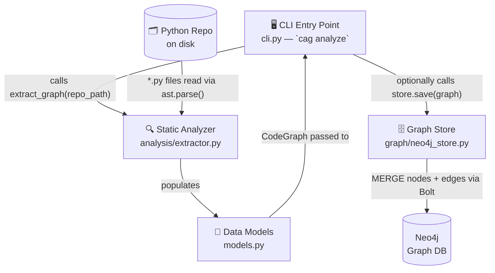
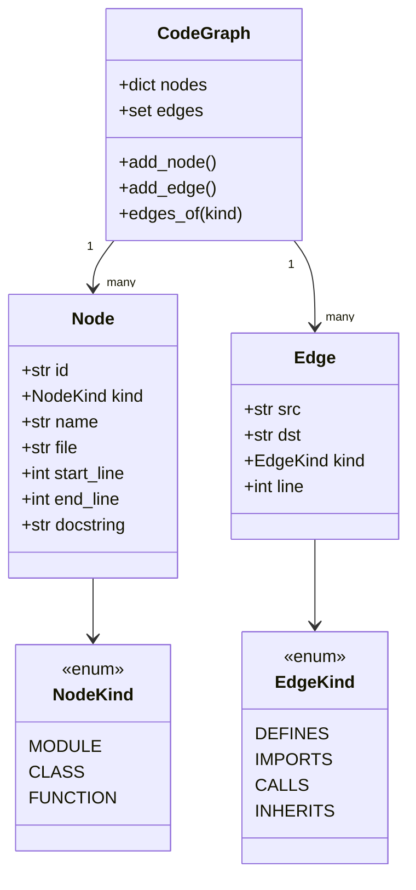
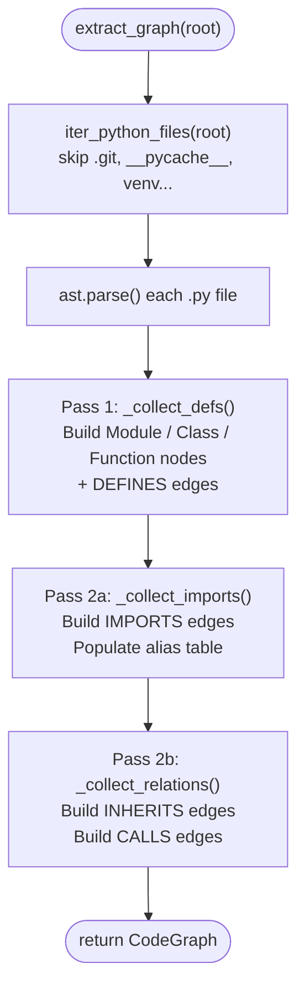
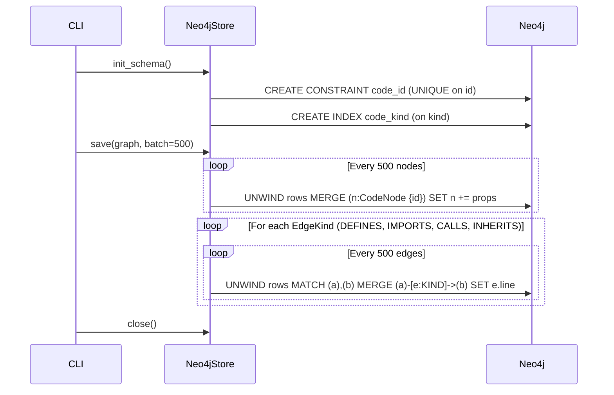
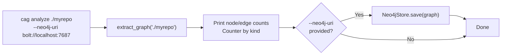
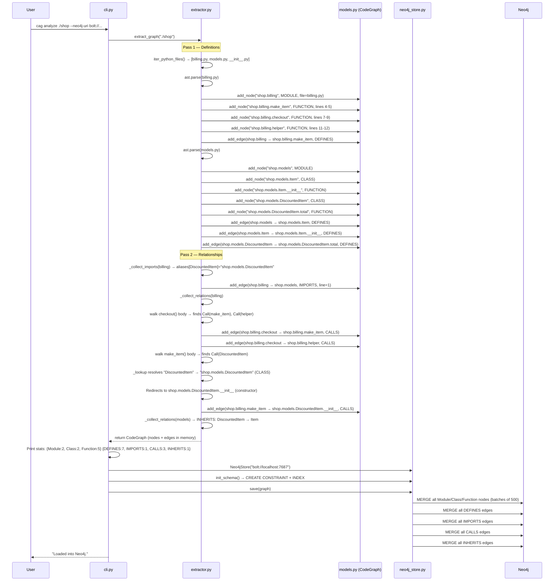
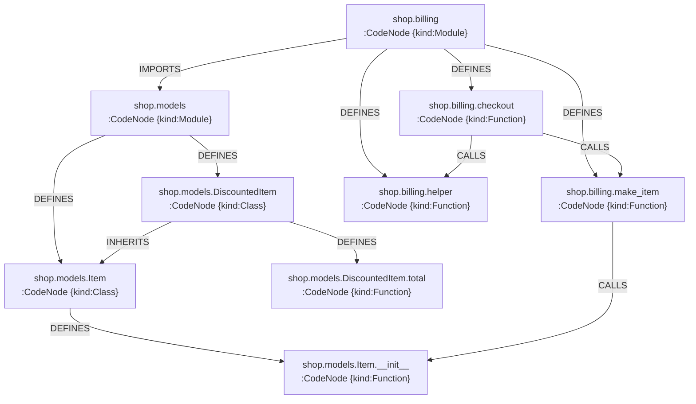

# CodeArchGuard — Milestone 1: Architecture & Data Flow Deep Dive

> [!NOTE]
> This document covers **Milestone 1 only** — the offline static code-graph extraction pipeline. It ties every file back to the design in the Phase 1 Project Documentation.

---

## 1. Where Milestone 1 Lives in the Full System

Your design splits the system into **two major stages**:

| Stage | Design Label | M1 Status |
|---|---|---|
| Offline Repository Indexing | Phase 1 in FR-01 → FR-05 | ✅ **Implemented here** |
| Online Query / GraphRAG / UI | Phase 2–4 (FR-06 → FR-13) | 🔜 Future milestones |

Milestone 1 is entirely the **"zero-token structural pipeline"** your design promised — it builds the property graph in Neo4j using nothing but Python's `ast` module and `jedi` (no LLM calls at all), satisfying **NFR-02** and **KPI: 0 LLM Tokens**.

---

## 2. Architectural Overview — Layers



The architecture has **4 clean layers** that match your FR-01–FR-03 requirements:

| Layer | File | Design Requirement |
|---|---|---|
| **CLI / Orchestrator** | `cli.py` | ties everything together |
| **Static Analyzer** | `analysis/extractor.py` | FR-02: AST + import resolution |
| **In-Memory Data Model** | `models.py` | FR-03: node/edge schema |
| **Graph Persistence** | `graph/neo4j_store.py` | FR-03: Neo4j property graph |

---

## 3. The Data Model — `models.py`

This is the **shared contract** between the analyzer and the database layer. Everything flows through these three dataclasses:



**Key design decision — the canonical `id`:** Every node's ID is a **fully qualified Python dotted path** like `shop.billing.checkout` or `shop.models.DiscountedItem.total`. This directly implements **Risk R-02** mitigation from your design — it prevents duplicate function name collisions because `module_a.utils.verify` and `module_b.utils.verify` get distinct IDs.

The design doc says the final ID should be `commit_hash::file_path::Class.function`. Milestone 1 uses the dotted module path — the commit hash will be layered on in a later milestone.

**The 4 node kinds vs your design:**

| Milestone 1 `NodeKind` | Design FR-03 label |
|---|---|
| `MODULE` | Module entry points |
| `CLASS` | Classes |
| `FUNCTION` | Functions + `pytest` cases (test nodes are just functions here) |
| *(future)* | `EntryPoint`, `Test`, `DocChunk` |

**The 4 edge kinds vs your design:**

| Milestone 1 `EdgeKind` | Design FR-03 label | Meaning |
|---|---|---|
| `DEFINES` | structural containment | `Module → Class/Function`, `Class → Method` |
| `IMPORTS` | cross-file dependency | `Module → Module` |
| `CALLS` | execution dependency | `Function → Function` |
| `INHERITS` | OOP hierarchy | `SubClass → BaseClass` |

> [!NOTE]
> The design also specifies `EXPOSES` (entry points), `TESTS` (test → target), and `DOCUMENTED_BY` (docs → code). These are **Phase 2 additions** not yet in M1.

---

## 4. The Static Analyzer — `analysis/extractor.py`

This is the heart of Milestone 1. It runs in **two sequential passes** over the entire repo — exactly the compiler-style two-pass approach your design calls for.



### Pass 1 — Definition Collection (`_collect_defs`)

The function walks every top-level statement in a file. When it finds a `ClassDef` or `FunctionDef`/`AsyncFunctionDef` AST node, it:

1. **Generates the qualified ID** by concatenating the parent prefix with the symbol name: `shop.models` + `.` + `DiscountedItem` = `shop.models.DiscountedItem`
2. **Creates a `Node`** with `kind`, `file`, `start_line`, `end_line`, and the docstring (via `ast.get_docstring()`)
3. **Creates a `DEFINES` edge** from parent to child
4. **Recurses** into class bodies so methods get IDs like `shop.models.DiscountedItem.total`

This recursion handles arbitrary nesting — a nested class inside a class inside a module all get correct IDs.

### Pass 2a — Import Resolution (`_collect_imports`)

This pass walks every `import X` and `from X import Y` statement and does two things:

1. **Populates an alias table** (`_FileInfo.aliases`): a local name lookup map used later by `_lookup()`. For example, in `billing.py`, `from shop.models import DiscountedItem` adds `{"DiscountedItem": "shop.models.DiscountedItem"}` to `billing`'s alias table.
2. **Adds `IMPORTS` edges**: calls `_link_module()` which walks up the dotted path to find the nearest *internal* module. This handles `from shop.models import DiscountedItem` correctly — it creates an `IMPORTS` edge `shop.billing → shop.models` (not to the external `DiscountedItem` symbol itself). External stdlib/third-party imports are silently skipped (no matching module in the repo's `modules` set).

The `_resolve_relative()` helper handles relative imports like `from . import models` by reconstructing the absolute module name using the caller's own package path.

### Pass 2b — Relationship Resolution (`_collect_relations`)

This pass builds the **semantic graph edges** — the ones that power your blast-radius queries.

**INHERITS edges:** For each `ClassDef`, it checks `stmt.bases` — the list of parent classes in the `class Foo(Base1, Base2):` declaration. It calls `_lookup()` to resolve the base class name against the alias table. If the result is a known `CLASS` node, an `INHERITS` edge is added.

**CALLS edges:** For each `FunctionDef`, it uses `ast.walk(stmt)` to find **every `ast.Call` node anywhere inside the function body**. For each call, `_dotted()` extracts the callee name as a dotted string (handles `obj.method()` and plain `func()` calls). Then `_lookup()` resolves it:

```
_lookup(graph, info, dotted, scope_cls) tries candidates in order:
  1. scope_cls.rest   → handles self.method() calls
  2. info.mod.dotted  → same-module calls
  3. aliases[head].rest → cross-file resolved calls
Returns the first candidate that exists in graph.nodes
```

This is the **import-alias-aware name resolution** that your design calls "cross-file symbol resolution via `jedi`" — in M1, `jedi` is listed as a dependency but the alias table approach handles the common cases. True jedi-powered resolution is a refinement for later.

> [!IMPORTANT]
> When a function calls a **class constructor** like `DiscountedItem(p)`, `_collect_relations` detects this by checking if the resolved target is a `CLASS` node, then redirects the `CALLS` edge to `DiscountedItem.__init__` if that method exists. This ensures constructor calls appear as function-level call edges in the graph.

---

## 5. The Graph Store — `graph/neo4j_store.py`

Once the in-memory `CodeGraph` is built, `Neo4jStore.save()` persists it to Neo4j using **idempotent `MERGE` operations** — running the same ingestion twice won't create duplicate nodes or edges. This directly supports **FR-01 (Git Snapshot Pinning)** since re-indexing the same commit produces the same graph.



**All nodes share the `:CodeNode` label** in Neo4j, with `kind` stored as a string property (`"Module"`, `"Class"`, `"Function"`). The design's FR-03 calls for distinct labels per type — this is a milestone 1 simplification; dedicated labels will be added later.

**Why edges are written per-kind in a loop:** Neo4j doesn't allow parameterizing relationship type names (you can't do `MERGE (a)-[e:$kind]->(b)`). So the code iterates `EdgeKind` and runs a separate Cypher statement for each, with the kind name hard-coded into the query string via an f-string.

---

## 6. The CLI — `cli.py`

The CLI is the entry point that orchestrates everything. You installed it as the `cag` command via `pyproject.toml`:

```
[project.scripts]
cag = "codearchguard.cli:main"
```

Running `cag analyze path/to/repo` does:



This means the analyzer runs even without Neo4j — you can verify the graph structure just from the printed stats, making local dev and testing zero-dependency.

---

## 7. Complete Data Flow — Start to Finish

Here is the full end-to-end data journey for `cag analyze tests/fixtures/sample_repo --neo4j-uri bolt://localhost:7687`:



---

## 8. What the Graph Looks Like in Neo4j

After ingestion of the `sample_repo`, the Neo4j graph contains:



This graph is what will power the **reverse BFS blast-radius queries** in Milestone 2 (FR-07). If you then ask "what breaks if I change `Item.__init__`?", Neo4j will traverse `CALLS` edges backwards from `shop.models.Item.__init__` and find `shop.billing.make_item` → `shop.billing.checkout` — exactly the transitive callers your design describes.

---

## 9. The Test Suite — Validating the Design

The test in [`test_extractor.py`](file:///c:/Users/meyad/Desktop/depi0/technical/grad_project/CodeArchGuard/codearchguard-milestone1/codearchguard-proj/tests/test_extractor.py) uses a minimal [`sample_repo`](file:///c:/Users/meyad/Desktop/depi0/technical/grad_project/CodeArchGuard/codearchguard-milestone1/codearchguard-proj/tests/fixtures/sample_repo) to assert 4 properties of the extractor:

| Test | What it Validates | Design Requirement |
|---|---|---|
| `test_nodes_found` | All key nodes are created with correct IDs | FR-02: AST symbol extraction |
| `test_defines_and_inherits` | Structural hierarchy + OOP edges work | FR-03: graph schema |
| `test_imports` | Cross-file `IMPORTS` edges resolved | FR-02: cross-file import resolution |
| `test_calls` | Multi-hop call chain discovered | FR-07 foundation (blast radius) |

The `sample_repo` is a controlled mini-project (like your design's "Controlled Python Sandbox" from the KPIs section) — it models a realistic pattern: `checkout` → `make_item` → `DiscountedItem.__init__` — a 2-hop call chain across two modules with inheritance, giving full coverage of all 4 edge kinds.

---

## 10. Design Gaps in Milestone 1 (Planned for Later)

| Design Requirement | Status in M1 | Notes |
|---|---|---|
| FR-01: Git commit hash pinning | ⚠️ Partial | Root path accepted, no `git rev-parse` yet |
| FR-04: Dynamic construct detection (`eval`/`getattr`) | ❌ Not yet | `has_dynamic_warning` flag not added |
| FR-05: Docstring + ADR embedding | ❌ Not yet | Docstrings extracted but not embedded |
| FR-03: Distinct node labels (`Function`, `Class`, etc.) | ⚠️ Simplified | All nodes use `:CodeNode` + `kind` property |
| FR-03: `EntryPoint`, `Test`, `DocChunk` node types | ❌ Not yet | `pytest` node traversal is Phase 2 |
| FR-09: Graph-scoped vector search | ❌ Not yet | Phase 2–3 |
| FR-10: Citation Verifier | ❌ Not yet | Phase 3 |

> [!TIP]
> The extractor already captures `docstring` on every node (line 28 in models.py, extracted via `ast.get_docstring()`). When FR-05 arrives, the embedding pipeline just needs to read from `node.docstring` — the foundation is already there.
