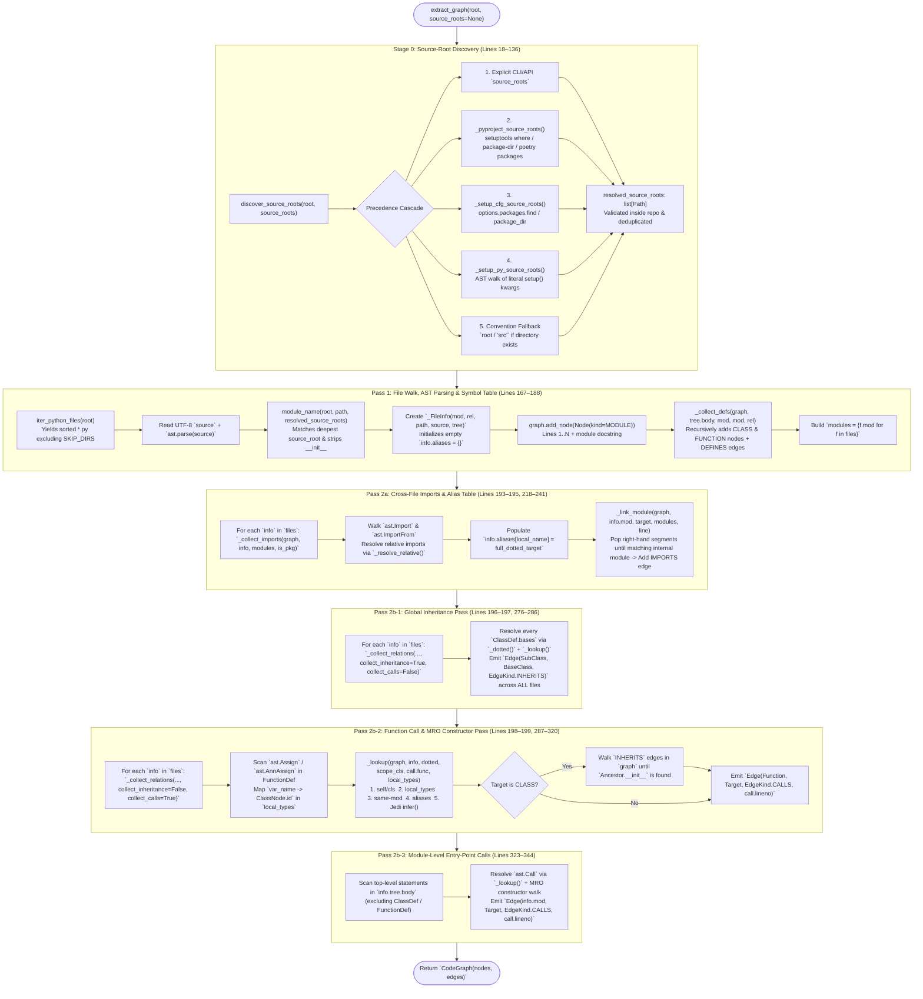

# CodeArchGuard — Milestone 1.5: Architecture Hardening & End-to-End Extractor Data Flow

> **Branch:** [`milestone-1.5`](https://github.com/Eyad-Helmy/DocHop/tree/milestone-1.5) ([Compare `main...milestone-1.5`](https://github.com/Eyad-Helmy/DocHop/compare/main...milestone-1.5))
> **Scope:** 6 commits (`+385 / -25` lines across 7 files) resolving all 5 static-analysis and blast-radius architectural gaps identified after Milestone 1.
> **Audience:** Full-team reference guide designed for both active contributors and teammates working on downstream modules (Neo4j Cypher queries, Vector RAG, Smart Router, Frontend UI, and QA Benchmarking) who need a complete mental model of how source code is transformed into a `CodeGraph`.

## 1. Executive Summary: Why Milestone 1.5 Exists

In Milestone 1 (`main`), `CodeArchGuard` introduced a zero-token, two-pass AST static analyzer (`src/codearchguard/analysis/extractor.py`) and a standalone NetworkX/Matplotlib visualizer (`visualize.py`). While Milestone 1 passed initial unit tests on a flat fixture repository (`tests/fixtures/sample_repo`), running the analyzer against real-world packaging layouts—including `CodeArchGuard` itself—exposed **five structural gaps**:

1. **Packaging Container Prefix Mismatch (`src/` Layout Bug):** Repositories placing packages inside `src/` (or custom containers like `backend/`) caused `module_name()` to prepend the container directory (`src.codearchguard.models`), which failed to match real Python import statements (`from codearchguard.models import ...`) and silently dropped cross-file `IMPORTS` and `CALLS` edges.
2. **Inherited Constructor Resolution Gap (MRO Disconnect):** When a function instantiated a subclass that did not define its own `__init__` (such as `make_item()` calling `DiscountedItem(p)` in `sample_repo`, where `DiscountedItem` inherits `__init__` from `Item`), the extractor checked only `DiscountedItem.__init__`, failed to find it, and left the `CALLS` edge pointing at the `Class` node (`shop.models.DiscountedItem`) instead of walking the `INHERITS` chain to `shop.models.Item.__init__`.
3. **Unresolved Local Instance Method Calls (`store.save(g)`):** Calling methods on a local variable holding a newly constructed object (such as `store = Neo4jStore(...)` followed by `store.init_schema()`, `store.save(g)`, `store.close()` in `cli.py`) produced no `CALLS` edges because `_lookup()` only checked `self`/`cls`, module-level names, and import aliases.
4. **Incomplete Blast-Radius Graph Traversal (`visualize.py`):** `compute_blast_radius()` reversed only `CALLS` edges, ignoring `INHERITS` (subclasses affected when a base class changes) and `DEFINES` (methods/functions owned by an impacted class or module).
5. **Untraced Module-Level Entry-Point Calls:** Top-level script statements executed outside any `def` or `class` block (such as `if __name__ == "__main__": main()` in `cli.py` or the entire CLI execution block in `visualize.py`) were skipped during call-graph extraction.

### Quantitative Impact on `DocHop` Self-Analysis (`cag analyze .`)

| Metric | Milestone 1 (`main`) | Milestone 1.5 (`milestone-1.5`) | Delta & Architectural Impact |
| :--- | :--- | :--- | :--- |
| **Total Extracted Nodes** | 56 | **61** | **+5 nodes** (new source-root discovery functions in `extractor.py`) |
| **Total Extracted Edges** | 66 | **115** | **+49 edges (+74.2% edge recall)** across the repository |
| **Cross-Module `IMPORTS` Edges** | 1 | **9** | All internal imports across `cli`, `extractor`, `neo4j_store`, `tests`, and `visualize` resolved |
| **Cross-Function/Module `CALLS` Edges** | 20 | **56** | Captures `cli.main -> Neo4jStore.save`, `visualize -> extract_graph`, and `make_item -> Item.__init__` |
| **Automated Regression Tests** | 4 tests (`1 file`) | **13 tests (`2 files`)** | **+9 new regression tests** across `tests/test_extractor.py` and `tests/test_visualize.py` |

## 2. Commit-by-Commit Changelog on `milestone-1.5`

All changes on [`milestone-1.5`](https://github.com/Eyad-Helmy/DocHop/compare/main...milestone-1.5) were structured into six atomic commits:

| Order | Commit Hash | Commit Message | Files Touched | Architectural Requirement Addressed |
| :--- | :--- | :--- | :--- | :--- |
| **1** | `f29de80` | `fixed src/ issue` | `extractor.py`, `cli.py`, `pyproject.toml`, `README.md` | **FR-02 / R-02:** Multi-strategy source-root discovery (`--source-root`, `pyproject.toml`, `setup.cfg`, `setup.py`, `src/` convention) so canonical module IDs match Python's import system. |
| **2** | `9a3b174` | `fixed inheritor class's no constuctor issue` | `extractor.py`, `tests/test_extractor.py` | **FR-02 / FR-03:** Split Pass 2b into an inheritance pass followed by a call pass, walking `INHERITS` edges (MRO) to resolve inherited `__init__` constructors. |
| **3** | `14531c3` | `Resolve local instance method calls` | `extractor.py` | **FR-02:** Added AST local assignment type tracking (`local_types`) + `jedi.Script.infer()` fallback inside `_lookup()` to resolve `instance.method()` calls. |
| **4** | `48dfaa6` | `Expand blast radius across architecture links` | `visualize.py` | **FR-07:** Extended `compute_blast_radius()` to traverse reversed `CALLS`, reversed `INHERITS`, and forward `DEFINES` edges. |
| **5** | `7acc345` | `Trace module-level calls in graph` | `extractor.py` | **FR-03 (EntryPoint foundation):** Added a top-level module statement walk in `_collect_relations()` to emit `Module -> Callee` `CALLS` edges. |
| **6** | `9f8a324` | `Add regression tests for architecture gaps` | `tests/test_extractor.py`, `tests/test_visualize.py` | **KPI Structural Recall:** Added 8 unit tests in `test_extractor.py` and created `test_visualize.py` verifying multi-edge blast-radius propagation. |

## 3. End-to-End Data Flow of `extractor.py` (From Start to Finish)

When `extract_graph(root, source_roots=None)` is called, raw files on disk pass through **6 sequential stages** (Stage 0 + Pass 1 + Pass 2a + Pass 2b-1 + Pass 2b-2 + Pass 2b-3) before returning the finished `CodeGraph`.



## 4. Deep-Dive into Each Architectural Stage & Code Change

### 4.1 Stage 0: Multi-Strategy Source-Root Discovery (`extractor.py:18–136`)

#### The Problem in Milestone 1
In Milestone 1, `module_name(root, file)` always computed a file's dotted module path directly from `file.relative_to(root)`:

```python
# Milestone 1 (Old):
def module_name(root: Path, file: Path) -> str:
    rel = file.relative_to(root).with_suffix("")
    parts = list(rel.parts)
    if parts and parts[-1] == "__init__":
        parts.pop()
    return ".".join(parts)
```

When analyzing a repository that uses Python's standard `src/` layout—such as `DocHop`, where `src/codearchguard/cli.py` imports `from codearchguard.analysis.extractor import extract_graph`—passing the repository root caused `module_name()` to assign the ID `src.codearchguard.analysis.extractor` instead of `codearchguard.analysis.extractor`. Because no file imported `src.codearchguard.*`, Pass 2 failed to match any internal module names in `modules` or `graph.nodes`.

#### How Milestone 1.5 Solves It (`discover_source_roots` + Enhanced `module_name`)
Milestone 1.5 introduces a **5-level configuration discovery cascade** (`discover_source_roots(root, source_roots)` at lines 99–121) that determines where importable packages live **before** Pass 1 begins:

| Priority | Discovery Source | Helper Function (`extractor.py`) | What It Inspects |
| :--- | :--- | :--- | :--- |
| **1 (Highest)** | Explicit CLI / API argument | `discover_source_roots(root, source_roots)` | Any path(s) passed via `cag analyze repo --source-root backend` or `extract_graph(repo, source_roots=[...])`. |
| **2** | `pyproject.toml` | `_pyproject_source_roots(root)` (Lines 24–49) | Parses `pyproject.toml` via `tomllib` (Python 3.11+) or `tomli` (Python 3.10) and extracts `[tool.setuptools.packages.find].where`, `[tool.setuptools.package-dir].""`, and `[[tool.poetry.packages]].from`. |
| **3** | `setup.cfg` | `_setup_cfg_source_roots(root)` (Lines 52–71) | Uses `configparser.ConfigParser` to read `[options.packages.find] where` and `[options] package_dir` root mappings (`= src`). |
| **4** | `setup.py` (Static AST) | `_setup_py_source_roots(root)` (Lines 74–96) | Parses `setup.py` using `ast.parse()` **without executing untrusted code** (satisfying **NFR-04 Security**), inspecting `setup()` keyword arguments `package_dir={"": "..."}` and `where="..."`. |
| **5 (Fallback)** | `src/` Convention | `discover_source_roots(root)` (Lines 105–106) | If no packaging config declares a root and `(root / "src").is_dir()` exists, defaults to `["src"]`. Unconfigured names like `backend/` are **not** stripped unless declared in config or via `--source-root`. |

Every discovered candidate directory is converted to an absolute path via `_path_from_root(root, value)` and validated with two strict guardrails (lines 112–118):
1. It must exist and be a directory (`candidate.is_dir()`).
2. It must reside inside the repository (`candidate.relative_to(root)`), preventing path-traversal outside the repo root.

Then, `module_name(root, file, source_roots)` (lines 124–136) selects the **deepest matching source root** (sorted by `len(p.parts)` descending) that contains `file`, falling back to `root` for files outside `src/` (such as `tests/test_extractor.py` or `visualize.py`):

```python
def module_name(root: Path, file: Path, source_roots: Iterable[Path] = ()) -> str:
    # Use the deepest matching root; otherwise retain the full repository path.
    source_root = next(
        (candidate for candidate in sorted(source_roots, key=lambda p: len(p.parts), reverse=True)
         if file.is_relative_to(candidate)),
        root,
    )
    # Convert ``source_root/pkg/file.py`` into ``pkg.file``.
    rel = file.relative_to(source_root).with_suffix("")
    parts = list(rel.parts)
    if parts and parts[-1] == "__init__":
        parts.pop()
    return ".".join(parts)
```

> **Why this design is so clean:** When `extract_graph("/path/to/DocHop")` runs on the repo root, `discover_source_roots()` reads `pyproject.toml` (`where = ["src"]`) and returns `[/path/to/DocHop/src]`.
> * For `src/codearchguard/cli.py`, `file.is_relative_to(src_root)` is `True`, so `mod` becomes `codearchguard.cli`, while `rel` (stored on `Node.file` for citations!) remains `src/codearchguard/cli.py` (`path.relative_to(root)`).
> * For `tests/test_extractor.py` and `visualize.py`, `file.is_relative_to(src_root)` is `False`, so `source_root` falls back to `root`, yielding `tests.test_extractor` and `visualize`. Both `src/` packages and top-level tests/scripts now coexist in the same unified graph!

### 4.2 Pass 1: File Discovery, `_FileInfo` State & Definition Collection (`extractor.py:145–215`)

In Pass 1, `extract_graph()` iterates over `iter_python_files(root)` (lines 174–188):

1. **Rich `_FileInfo` State Container (Lines 145–148):**
   In Milestone 1, `_FileInfo` only stored `(mod, rel, tree)`. In Milestone 1.5, `_FileInfo` was expanded to store `path: Path` and `source: str` alongside `tree: ast.Module`:
   ```python
   class _FileInfo:
       def __init__(self, mod: str, rel: str, path: Path, source: str, tree: ast.Module):
           self.mod, self.rel, self.path, self.source, self.tree = mod, rel, path, source, tree
           self.aliases: dict[str, str] = {}  # local name -> dotted target
   ```
   **Why `path` and `source` were added:** Storing the raw `source` string and filesystem `path` in memory during Pass 1 allows `_lookup()` in Pass 2b to pass `code=info.source, path=str(info.path)` directly to `jedi.Script(...)` without re-reading disk on every unresolved function call.

2. **Module & Recursive Symbol Registration (`_collect_defs`, Lines 203–215):**
   * Adds a `NodeKind.MODULE` node for the file itself (`start_line=1`, `end_line=len(splitlines())`, `docstring=ast.get_docstring(tree)`).
   * Calls `_collect_defs(graph, tree.body, mod, mod, rel)`, which walks every `ast.ClassDef` and `ast.FunctionDef` / `ast.AsyncFunctionDef`, registers their `Node` in `graph.nodes`, creates a `DEFINES` edge (`parent_id -> child_id`), and recurses into `stmt.body` so methods (`Class.method`) and nested classes/functions receive canonical dotted IDs.
   * After all files complete Pass 1, line 188 snapshots the set of all internal module IDs:
     ```python
     modules = {f.mod for f in files}
     ```

### 4.3 Pass 2a: Import Resolution & Alias Table Construction (`extractor.py:193–195, 218–241`)

Before any inheritance or call relationships are inspected, `extract_graph()` runs `_collect_imports(graph, info, modules, is_pkg)` across all files:

* **`ast.Import` (`import pkg.sub as alias`):**
  * Maps `(a.asname or a.name).split(".")[0]` in `info.aliases` to `a.name` (if aliased) or the top-level package name.
  * Calls `_link_module(graph, info.mod, a.name, modules, node.lineno)` to add an `EdgeKind.IMPORTS` edge.
* **`ast.ImportFrom` (`from .models import DiscountedItem as DI`):**
  * If `node.level > 0` (relative import), calls `_resolve_relative(info.mod, is_pkg, node.level, node.module)` to compute the absolute base module.
  * Records `info.aliases[a.asname or a.name] = f"{base}.{a.name}"` (e.g., `info.aliases["DiscountedItem"] = "shop.models.DiscountedItem"`).
  * Calls `_link_module()`, which walks up the dotted segments (`shop.models.DiscountedItem` → `shop.models`) until it finds the longest match in `modules`, emitting `Edge("shop.billing", "shop.models", EdgeKind.IMPORTS, line=1)`. External standard-library or third-party imports (`ast`, `pathlib`, `neo4j`) never match `modules` and are cleanly ignored.

### 4.4 Why Pass 2b Was Split into Two Sub-Passes (`extractor.py:196–200`)

One of the smartest architectural changes in Milestone 1.5 is lines 196–199 of `extract_graph()`:

```python
    for info in files:
        _collect_relations(graph, info, collect_inheritance=True, collect_calls=False)
    for info in files:
        _collect_relations(graph, info, collect_inheritance=False, collect_calls=True)
```

#### Why This Ordering Matters
Suppose `billing.py` is alphabetically processed **before** `models.py` (`iter_python_files` sorts paths alphabetically, so `shop/billing.py` runs before `shop/models.py`!).
* In `shop/billing.py`, `make_item(p)` calls `DiscountedItem(p)`.
* To resolve `DiscountedItem(p)` to its inherited constructor `shop.models.Item.__init__`, the analyzer needs to know that `shop.models.DiscountedItem` `INHERITS` from `shop.models.Item`.
* In Milestone 1, inheritance and calls were collected in a **single loop per file**. Because `shop/billing.py` was visited before `shop/models.py`, the edge `DiscountedItem --[INHERITS]--> Item` did not exist yet when `billing.py` was analyzed!
* By splitting `_collect_relations` into **Pass 2b-1 (`collect_inheritance=True, collect_calls=False` across all files)** followed by **Pass 2b-2 (`collect_inheritance=False, collect_calls=True` across all files)**, every `INHERITS` edge in the entire repository is guaranteed to exist in `graph.edges` before a single constructor call is resolved.

### 4.5 Pass 2b-2: Local Instance Type Inference, 5-Stage `_lookup()` & MRO Constructor Walk (`extractor.py:244–320`)

When `collect_calls=True` runs on each `FunctionDef` / `AsyncFunctionDef`, Milestone 1.5 executes three mechanisms:

#### Mechanism A: Local Constructor Assignment Scanner (`local_types`, Lines 288–299)
Before walking the calls inside a function body, `_collect_relations` scans all `ast.Assign` (`store = Neo4jStore(...)`) and `ast.AnnAssign` (`store: Neo4jStore = Neo4jStore(...)`) nodes inside that function:

```python
local_types = {}
for assigned in (n for n in ast.walk(stmt) if isinstance(n, (ast.Assign, ast.AnnAssign))):
    value = assigned.value
    if not isinstance(value, ast.Call):
        continue
    target = _lookup(graph, info, _dotted(value.func) or "", scope_cls)
    if not target or graph.nodes[target].kind != NodeKind.CLASS:
        continue
    targets = assigned.targets if isinstance(assigned, ast.Assign) else [assigned.target]
    for name in targets:
        if isinstance(name, ast.Name):
            local_types[name.id] = target
```

In `cli.py`'s `main()`, `store = Neo4jStore(args.neo4j_uri, ...)` is an `ast.Assign` whose RHS is an `ast.Call` to `Neo4jStore`. `_lookup` resolves `Neo4jStore` via `info.aliases["Neo4jStore"]` to the `CLASS` node `codearchguard.graph.neo4j_store.Neo4jStore`. Thus:
```python
local_types["store"] = "codearchguard.graph.neo4j_store.Neo4jStore"
```

#### Mechanism B: The 5-Tier Symbol Resolution Cascade (`_lookup`, Lines 244–273)
When `stmt` subsequently calls `store.init_schema()`, `store.save(g)`, or `DiscountedItem(p)`, `_lookup(graph, info, dotted, scope_cls, call.func, local_types)` partitions `dotted` into `head, _, rest` and checks candidates in strict priority order:

| Tier | Condition | Candidate Formula | Example Resolved |
| :--- | :--- | :--- | :--- |
| **1. Enclosing Class (`self`/`cls`)** | `head in ("self", "cls") and scope_cls and rest` | `f"{scope_cls}.{rest}"` | `self.total()` inside `DiscountedItem` → `shop.models.DiscountedItem.total` |
| **2. Local Instance Variable (`local_types`)** | `local_types and head in local_types and rest` | `f"{local_types[head]}.{rest}"` | `store.save(g)` inside `cli.main` → `codearchguard.graph.neo4j_store.Neo4jStore.save` |
| **3. Same-Module Symbol** | Always checked | `f"{info.mod}.{dotted}"` | `make_item(p)` inside `shop.billing` → `shop.billing.make_item` |
| **4. Imported Alias Table** | `head in info.aliases` | `f"{tgt}.{rest}" if rest else tgt` | `DiscountedItem(p)` inside `shop.billing` → `shop.models.DiscountedItem` |
| **5. Jedi Type Inference Fallback** | If Tiers 1–4 miss and `node is not None` | `jedi.Script(code=info.source, path=str(info.path)).infer(...)` | Complex chained calls, factory return values, or context-manager targets |

#### Mechanism C: Cycle-Safe MRO Constructor Walk (Lines 304–318)
Whenever `_lookup()` resolves a call target `t` to a `NodeKind.CLASS` node (meaning the code is invoking a class constructor like `DiscountedItem(p)`), Milestone 1.5 walks up the `INHERITS` graph until it finds the first ancestor that defines `__init__`:

```python
if graph.nodes[t].kind == NodeKind.CLASS:  # constructor call
    constructor = t
    visited = set()
    while constructor and constructor not in visited:
        visited.add(constructor)
        initializer = f"{constructor}.__init__"
        if initializer in graph.nodes:
            t = initializer
            break
        constructor = next(
            (edge.dst for edge in graph.edges_of(EdgeKind.INHERITS)
             if edge.src == constructor),
            None,
        )
graph.add_edge(Edge(fid, t, EdgeKind.CALLS, call.lineno))
```

* **Cycle Safety:** The `visited = set()` guard ensures that even if a repository contains malformed cyclic inheritance (`class A(B)` and `class B(A)`), the `while` loop terminates cleanly.
* **Fallback Behavior:** If neither the class nor any of its internal base classes defines an explicit `__init__` (for example, `class Item: pass` using Python's default `object.__init__`), `t` remains the `CLASS` node (`app.models.Item`), so the call dependency to the class is still preserved.

### 4.6 Pass 2b-3: Module-Level Entry-Point Call Tracing (`extractor.py:323–344`)

After `visit(info.tree.body, info.mod, None)` finishes inspecting all classes and functions in a file, Milestone 1.5 runs a second loop over top-level module statements (lines 323–344):

```python
    if collect_calls:
        for stmt in info.tree.body:
            if isinstance(stmt, (ast.ClassDef, ast.FunctionDef, ast.AsyncFunctionDef)):
                continue
            for call in (n for n in ast.walk(stmt) if isinstance(n, ast.Call)):
                d = _dotted(call.func)
                target = _lookup(graph, info, d, None, call.func) if d else None
                if target and target != info.mod:
                    # ... (same cycle-safe MRO constructor resolution) ...
                    graph.add_edge(Edge(info.mod, target, EdgeKind.CALLS, call.lineno))
```

* **Why `isinstance(stmt, (ClassDef, FunctionDef, AsyncFunctionDef))` is skipped:** `ast.walk(stmt)` traverses all descendant AST nodes recursively. Skipping top-level class and function definitions prevents double-counting calls inside functions as module-level calls, while still walking `if __name__ == "__main__":`, top-level variable initializations, and script commands.
* **Concrete Impact on `DocHop`:**
  * In `src/codearchguard/cli.py`, line 27 (`if __name__ == "__main__": main()`) now generates `codearchguard.cli --[CALLS (L27)]--> codearchguard.cli.main`.
  * In `visualize.py`, lines 225–239 now generate 5 `CALLS` edges from the `visualize` module node to `extract_graph`, `print_text_tree`, `build_nx_graph`, `compute_blast_radius`, and `draw_graph`.

### 4.7 Multi-Relational Blast-Radius Expansion (`visualize.py:54–68`)

In Milestone 1, `compute_blast_radius(G, start)` only reversed `EdgeKind.CALLS`. In Milestone 1.5 (commit `48dfaa6`), it builds an `affected` directed propagation graph combining three edge semantics:

```python
def compute_blast_radius(G: nx.DiGraph, start: str) -> set[str]:
    """Find callers, subclasses, and members affected by a changed symbol."""
    affected = nx.DiGraph()
    for u, v, data in G.edges(data=True):
        if data.get("kind") == EdgeKind.CALLS:
            affected.add_edge(v, u)  # callers: if v changes, caller u is affected
        elif data.get("kind") == EdgeKind.INHERITS:
            affected.add_edge(v, u)  # subclasses: if base v changes, subclass u is affected
        elif data.get("kind") == EdgeKind.DEFINES:
            affected.add_edge(u, v)  # members: if container u changes, member v is affected
    if start not in affected:
        return {start}
    return set(nx.descendants(affected, start)) | {start}
```

Notice the directional asymmetry—this is a crucial design detail:
* **`CALLS` is reversed (`v -> u`):** If `checkout` (`u`) calls `make_item` (`v`), modifying `make_item` propagates impact upstream to `checkout`.
* **`INHERITS` is reversed (`v -> u`):** If `DiscountedItem` (`u`) inherits from `Item` (`v`), modifying `Item` propagates impact downstream to `DiscountedItem` (and from `DiscountedItem` to any caller of `DiscountedItem`).
* **`DEFINES` is kept forward (`u -> v`):** If a class `Item` (`u`) defines method `Item.total` (`v`), modifying or refactoring `Item` encompasses its defined members (`Item.total`), whereas modifying a single method does not automatically mark the entire parent module as the root cause.

## 5. Complete Trace Walkthrough: `sample_repo` from Start to Finish

To see every data structure mutate in real time, here is the exact execution trace of `extract_graph("tests/fixtures/sample_repo")` in Milestone 1.5:

```mermaid
sequenceDiagram
    autonumber
    participant Caller as Caller / CLI
    participant Disc as discover_source_roots()
    participant P1 as Pass 1: _collect_defs()
    participant P2A as Pass 2a: _collect_imports()
    participant P2B1 as Pass 2b-1: Inheritance
    participant P2B2 as Pass 2b-2: Calls & MRO

    Caller->>Disc: extract_graph("tests/fixtures/sample_repo")
    Disc-->>Caller: resolved_source_roots = [] (no pyproject/setup/src; uses root)

    rect rgb(20, 40, 60)
    Note over Caller,P1: Pass 1 — Scan shop/__init__.py, shop/billing.py, shop/models.py
    Caller->>P1: Parse shop/__init__.py -> mod="shop"
    P1-->>Caller: Add Node("shop", MODULE)
    Caller->>P1: Parse shop/billing.py -> mod="shop.billing"
    P1-->>Caller: Add MODULE "shop.billing" + 3 FUNCTION nodes (make_item, checkout, helper) + 3 DEFINES edges
    Caller->>P1: Parse shop/models.py -> mod="shop.models"
    P1-->>Caller: Add MODULE "shop.models", CLASS "Item", FUNC "Item.__init__", CLASS "DiscountedItem", FUNC "DiscountedItem.total" + 4 DEFINES edges
    Note over Caller: modules = {"shop", "shop.billing", "shop.models"} (10 nodes, 7 DEFINES edges)
    end

    rect rgb(45, 35, 20)
    Note over Caller,P2A: Pass 2a — Resolve Imports & Populate _FileInfo.aliases
    Caller->>P2A: _collect_imports(shop.billing)
    P2A-->>Caller: Line 1 (`from shop.models import DiscountedItem`):<br/>aliases["DiscountedItem"] = "shop.models.DiscountedItem"<br/>Add Edge("shop.billing" -> "shop.models", IMPORTS, L1)
    P2A-->>Caller: Line 2 (`from . import models`):<br/>_resolve_relative("shop.billing", False, 1, "models") -> "shop.models"<br/>aliases["models"] = "shop.models"<br/>Add Edge("shop.billing" -> "shop.models", IMPORTS, L2)
    end

    rect rgb(45, 20, 55)
    Note over Caller,P2B1: Pass 2b-1 — Collect INHERITS Across All Files First
    Caller->>P2B1: _collect_relations(shop.models, collect_inheritance=True, collect_calls=False)
    P2B1-->>Caller: Class DiscountedItem(Item): _lookup("Item") -> "shop.models.Item" (CLASS)<br/>Add Edge("shop.models.DiscountedItem" -> "shop.models.Item", INHERITS, L5)
    end

    rect rgb(20, 50, 35)
    Note over Caller,P2B2: Pass 2b-2 — Collect CALLS & Walk MRO for Constructors
    Caller->>P2B2: _collect_relations(shop.billing, collect_inheritance=False, collect_calls=True)
    P2B2-->>Caller: In make_item() L5: Call `DiscountedItem(p)`<br/>1. _lookup("DiscountedItem") -> "shop.models.DiscountedItem" (CLASS)<br/>2. Check "shop.models.DiscountedItem.__init__" in graph.nodes -> False<br/>3. Follow INHERITS edge to "shop.models.Item"<br/>4. Check "shop.models.Item.__init__" in graph.nodes -> True!<br/>5. Add Edge("shop.billing.make_item" -> "shop.models.Item.__init__", CALLS, L5)
    P2B2-->>Caller: In checkout() L8-L9: Add CALLS to "shop.billing.make_item" (L8) and "shop.billing.helper" (L9)
    end
```

## 6. Test Suite Verification Matrix (`tests/test_extractor.py` & `tests/test_visualize.py`)

Milestone 1.5 expands the automated test suite from 4 tests to **13 tests** covering every edge case:

| Test File & Function | Scenario Under Test | Key Assertion Verified |
| :--- | :--- | :--- |
| `test_extractor.py::test_nodes_found` | Pass 1 symbol extraction on `sample_repo` | `"shop.billing"`, `"shop.models.Item"`, `"shop.billing.checkout"`, `"shop.models.DiscountedItem.total"` exist in `g.nodes` |
| `test_extractor.py::test_defines_and_inherits` | Structural containment & OOP base class resolution | `("shop.models", "shop.models.Item") in DEFINES` and `("shop.models.DiscountedItem", "shop.models.Item") in INHERITS` |
| `test_extractor.py::test_imports` | Cross-file absolute & relative import resolution | `("shop.billing", "shop.models") in IMPORTS` |
| `test_extractor.py::test_calls` | Multi-hop call graph & inherited constructor MRO walk | `("shop.billing.make_item", "shop.models.Item.__init__") in CALLS` and `("shop.billing.make_item", "shop.models.DiscountedItem") not in CALLS` |
| `test_extractor.py::test_repo_root_src_layout_uses_importable_module_names` | Convention `src/` directory fallback | `app.models` in `graph.nodes`, `src.app.models` not in `graph.nodes`, and cross-file `IMPORTS`/`CALLS` resolve |
| `test_extractor.py::test_explicit_source_root_supports_nonstandard_container` | Explicit `source_roots=["backend"]` parameter | `backend/app/models.py` maps to `app.models` and resolves `from app.models import Item` |
| `test_extractor.py::test_pyproject_source_root_supports_nonstandard_container` | `pyproject.toml` `[tool.setuptools.packages.find]` discovery | Reads `where = ["backend"]` via `tomllib`/`tomli` and maps `backend/app` to `app` |
| `test_extractor.py::test_setup_cfg_source_root_supports_nonstandard_container` | `setup.cfg` `[options] package_dir` discovery | Parses `= backend` via `configparser` and maps `backend/app` to `app` |
| `test_extractor.py::test_setup_py_source_root_supports_nonstandard_container` | Static AST inspection of `setup.py` | Extracts `package_dir={"": "backend"}` via `ast.walk()` without executing `setup.py` |
| `test_extractor.py::test_unknown_container_is_not_stripped` | Guardrail against stripping arbitrary subdirectories | Unconfigured `backend/app` remains `backend.app` when not declared in config |
| `test_extractor.py::test_local_instance_method_calls_are_resolved` | `local_types` assignment tracking (`store = Neo4jStore()`) | `("cli.main", "store.Neo4jStore.init_schema")`, `save`, and `close` all appear in `CALLS` |
| `test_extractor.py::test_module_level_calls_are_traced` | Top-level entry-point calls outside `def`/`class` | `work()` at top level of `entry.py` emits `("entry", "helpers.work")` in `CALLS` |
| `test_visualize.py::test_blast_radius_follows_calls_inheritance_and_definitions` | Multi-relational blast-radius propagation | Blast radius from `shop.models.Item` includes `Item`, `Item.total` (`DEFINES`), `DiscountedItem` (`INHERITS`), `make_item` (`CALLS`), and `checkout` (`CALLS`) |

## 7. Remaining Roadmap Items Moving into Phase 2

With Milestone 1.5 complete, the static Python call/inheritance/import graph foundation is solid. The next milestones in Phase 2 (`Weeks 3–4`) build directly on these structures:

1. **Both Constructor Edge & Class Dependency for Subclass Instantiation (Optional Refinement):** Notice that when `make_item()` calls `DiscountedItem(p)` and MRO redirects the `CALLS` edge directly to `shop.models.Item.__init__`, `make_item()` no longer has a direct edge to `shop.models.DiscountedItem`. If someone queries the blast radius starting from `shop.models.DiscountedItem`, `make_item()` won't be reached unless either `make_item` also links to `DiscountedItem` or `DiscountedItem` links to `Item.__init__`. Adding an edge `DiscountedItem --[CALLS]--> Item.__init__` (representing the implicit `super().__init__` delegation) while keeping `make_item --[CALLS]--> DiscountedItem` is a great Phase 2 enhancement so both `DiscountedItem` and `Item.__init__` blast-radius queries catch `make_item()`.
2. **Git Commit Hash Pinning & `has_dynamic_warning` (**FR-01**, **FR-04**):** Prefix node IDs with the repository's short commit SHA and flag `eval()`, `exec()`, and `getattr()` calls during the AST walk.
3. **Markdown ADR & Docstring Vector Indexing (**FR-05**, **FR-09**):** Attach `:DocChunk` nodes via `DOCUMENTED_BY` edges and embed them with `BAAI/bge-small-en-v1.5`.
4. **Cypher Reverse-BFS & `pytest` Selector (**FR-07**, **FR-08**):** Port the multi-relational blast-radius logic from `visualize.py` into parameterized Neo4j Cypher queries and link `:Test` nodes via `TESTS` edges.
