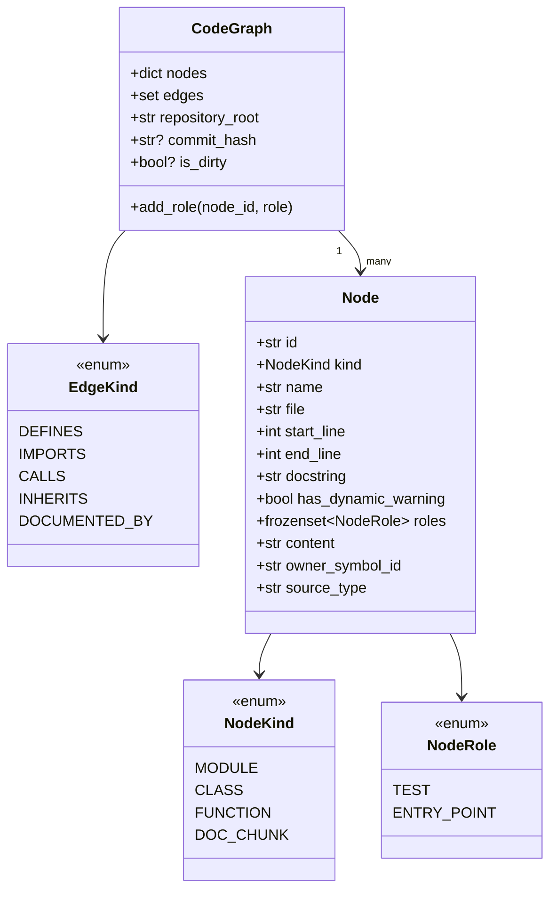
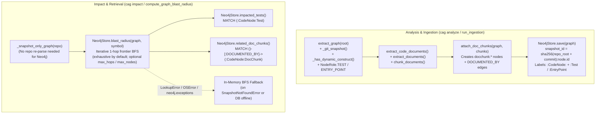

# CodeArchGuard — Milestone 3: Snapshot Metadata, DocChunk Graph, Neo4j Impact Queries & CLI

> **Branches & Commits:**
> * `5f84eec` (`feat: add repository snapshot analysis metadata`)
> * `2824449` (`DocChunks added and changes applied to Neo4j`)
> * `0279e6e` (`Neo4j blast radius query` on `feature/neo4j-impact-queries`: exhaustive frontier-based Neo4j BFS, retriever delegation, `cag` CLI `analyze`/`impact`)
> **Requirements Addressed:** **FR-03** (Node Roles `Test`/`EntryPoint`, `DocChunk` & `DOCUMENTED_BY` Schema), **FR-04** (Dynamic Construct Warnings), **FR-06 / FR-07** (Snapshot-Scoped Neo4j Persistence & Exhaustive Blast-Radius Impact Queries), **FR-08** (Impacted Test & Documentation Discovery via CLI and Graph DB).  
> **Audience:** Full-team reference guide (Static Analysis, Graph DB Engineers, RAG Pipeline, CLI/UI, QA & Architecture Reviewers).

---

## 1. Executive Summary: Why Milestone 3 Exists

After **Milestone 2** delivered the in-memory GraphRAG pipeline (`rag/`) and interactive demo UI (`ui-2.py`), the next step was closing the gap between **in-memory Python analysis** and **persistent, multi-repo Neo4j graph intelligence**:

1. **Multi-Repo & Multi-Commit Collisions in Neo4j:** Previously, `Neo4jStore` enforced a global unique constraint on `CodeNode.id`. Analyzing two repositories with overlapping symbol names (e.g. `main`) or two commits of the same repository silently overwrote existing nodes.
2. **Missing Behavioural Roles & Static Risk Flags:** The graph had structural `NodeKind`s (`Module`, `Class`, `Function`) but did not distinguish test code (`Test`), script entry points (`EntryPoint`), or symbols using dynamic runtime constructs (`eval`, `exec`, `__import__`, `importlib.import_module`, dynamic `getattr`).
3. **Disconnected RAG Chunks:** `DocChunk`s existed only as in-memory RAG `Chunk` objects and were not persisted in Neo4j or linked to code symbols via `DOCUMENTED_BY` edges.
4. **No Database-Side Impact Queries or Unified CLI:** Blast-radius traversal only existed in Python memory (`graph_scoped_retriever.py` / `visualize.py`), and `cag` (`cli.py`) only printed raw `extract_graph()` counts without roles, `DocChunk`s, or impact querying.

### Key Pillars Implemented

1. **Repository Snapshot Metadata, Dynamic Construct Warnings & Behavioural Roles (`models.py`, `analysis/extractor.py` — `5f84eec`):**
   * Attaches `repository_root`, `commit_hash`, and `is_dirty` to `CodeGraph` via `_git_snapshot()`.
   * Adds non-exclusive `NodeRole.TEST` and `NodeRole.ENTRY_POINT` to `Node.roles` without altering `Node.kind`.
   * Flags `Node.has_dynamic_warning` strictly on the directly enclosing symbol when dynamic constructs are detected.
2. **`DocChunk` Graph Nodes & Snapshot-Scoped Neo4j Storage (`rag/doc_graph.py`, `graph/neo4j_store.py`, `rag/pipeline.py` — `2824449`):**
   * Introduces `NodeKind.DOC_CHUNK`, `EdgeKind.DOCUMENTED_BY`, and `attach_doc_chunks(graph, chunks)` with `docchunk:` ID namespacing.
   * Migrates Neo4j's legacy `code_id` constraint non-destructively (`legacy:<id>`) and namespaces every node by `sha256(repository_root + commit_hash)` (`snapshot_id`).
   * Persists `:DocChunk` nodes, `:Test` / `:EntryPoint` Neo4j labels, `has_dynamic_warning`, snapshot metadata, and `:DOCUMENTED_BY` edges.
3. **Exhaustive Frontier-Based Neo4j Blast Radius, Impact Queries & `cag` CLI (`graph/neo4j_store.py`, `rag/graph_scoped_retriever.py`, `cli.py` — `feature/neo4j-impact-queries`):**
   * Implements `Neo4jStore.blast_radius()`, `impacted_tests()`, and `related_doc_chunks()` using iterative **1-hop frontier expansion** (exhaustive by default, with optional `max_hops` and `max_nodes` safety bounds).
   * Wires `compute_graph_blast_radius(..., neo4j_store=...)` to query Neo4j first and fall back transparently to in-memory BFS when the snapshot or database is unavailable.
   * Upgrades `cag analyze` (snapshot, roles, dynamic warnings, `DocChunk`s) and adds `cag impact <repo> <symbol>` for both in-memory and Neo4j impact analysis.

---

## 2. Commit & Change Log Since Milestone 2

| Order | Reference | Summary | Files Touched | Architectural Requirement |
| :---: | :--- | :--- | :--- | :--- |
| **1** | `5f84eec` | `feat: add repository snapshot analysis metadata` | `models.py`, `analysis/extractor.py`, `ui-2.py`, `tests/test_extractor.py` | Git snapshot metadata (`commit_hash`, `is_dirty`), scoped `has_dynamic_warning`, `NodeRole.TEST` & `NodeRole.ENTRY_POINT`. |
| **2** | `2824449` | `DocChunks added and changes applied to Neo4j` | `models.py`, `rag/doc_graph.py`, `rag/pipeline.py`, `graph/neo4j_store.py`, `ui-2.py`, `visualize.py`, `tests/test_doc_graph.py`, `tests/test_neo4j_store.py` | `NodeKind.DOC_CHUNK`, `EdgeKind.DOCUMENTED_BY`, `attach_doc_chunks()`, legacy Neo4j schema migration, snapshot-scoped `Neo4jStore.save()`. |
| **3** | *(working tree)* | `feature/neo4j-impact-queries` | `graph/neo4j_store.py`, `rag/graph_scoped_retriever.py`, `cli.py`, `tests/test_neo4j_store.py`, `tests/test_graph_scoped_retriever.py`, `tests/test_cli.py` | Exhaustive 1-hop frontier Neo4j BFS, `impacted_tests()`, `related_doc_chunks()`, retriever Neo4j delegation + fallback, `cag analyze` & `cag impact`. |

---

## 3. End-to-End System Architecture & Data Flow

### Updated Data Model (`models.py`)



### Persistence & Query Flow



---

## 4. Deep-Dive into Each Feature & Code Change

### 4.1 Feature 1: Snapshot Metadata, Dynamic Construct Warnings & Node Roles (`5f84eec`)

#### Git Snapshot Metadata (`extractor.py:170–183, 258–263`)
* `_git_snapshot(root)` executes `git -C <root> rev-parse HEAD` and `git -C <root> status --porcelain` (5-second timeout).
* Outside a Git repository or on `OSError`/`SubprocessError`, it returns `(None, None)` explicitly rather than fabricating values.
* Populates `CodeGraph.repository_root` (`str(root.resolve())`), `commit_hash`, and `is_dirty`.

#### Scoped Dynamic Construct Warnings (`extractor.py:186–236`)
* `_import_aliases(tree)` records static `import` and `from importlib import import_module` aliases (e.g. `import importlib as il`).
* `_has_dynamic_construct(body, aliases)` walks a node's statements while **short-circuiting nested `ClassDef`, `FunctionDef`, and `AsyncFunctionDef`** so warnings attach only to the symbol containing the dynamic call, not every enclosing container.
* Flags `eval`, `exec`, `__import__`, `importlib.import_module` (resolved through aliases), and `getattr(obj, attr)` when `attr` is **not** a string literal (`getattr(obj, "name")` remains warning-free).

#### Non-Exclusive Behavioural Roles (`models.py:14–18, 67–71`, `extractor.py:239–251, 280–331`)
* `CodeGraph.add_role(node_id, role)` uses `dataclasses.replace()` to preserve `Node`'s `frozen=True` immutability.
* **`NodeRole.TEST`:** Applied to modules matching `test_*.py` or `*_test.py` (`_is_test_file`), classes named `Test*`, and functions/methods named `test_*`.
* **`NodeRole.ENTRY_POINT`:** `_mark_entry_points()` scans top-level `if __name__ == "__main__":` guards (`_is_main_guard`), marks the module as `ENTRY_POINT`, and marks any statically resolved call target inside that guard as `ENTRY_POINT`.

---

### 4.2 Feature 2: `DocChunk` Graph Nodes & Snapshot-Scoped Neo4j Storage (`2824449`)

#### Attaching RAG Chunks to `CodeGraph` (`rag/doc_graph.py:1–39`, `rag/pipeline.py:45`)
* `doc_chunk_node_id(chunk)` namespaces chunk IDs as `docchunk:{chunk.id}` so they cannot collide with Python symbol IDs.
* `attach_doc_chunks(graph, chunks)` adds a `NodeKind.DOC_CHUNK` node (populating `content`, `owner_symbol_id`, `source_type`) for each `Chunk`, and adds `Edge(chunk.owner_symbol_id, node_id, EdgeKind.DOCUMENTED_BY, chunk.start_line)` whenever `owner_symbol_id in graph.nodes`.
* Repository-level Markdown files using the `"__repo__"` sentinel remain unlinked `DocChunk` nodes rather than creating dangling edges.

#### Non-Destructive Neo4j Schema Migration & Snapshot Isolation (`graph/neo4j_store.py:9–25, 71–137`)
* **`init_schema()`:**
  * Drops the legacy `code_id` constraint (`DROP CONSTRAINT code_id IF EXISTS`).
  * Backfills existing nodes lacking `snapshot_id` with `SET n.snapshot_id = 'legacy:' + n.id` so older graphs are preserved rather than deleted.
  * Creates `code_snapshot_id` unique constraint on `n.snapshot_id` plus indexes on `n.kind` and `n.owner_symbol_id`.
* **`_snapshot_namespace(graph)`:**
  * Computes `sha256(f"{graph.repository_root}\0{graph.commit_hash or 'unversioned'}")`.
  * `is_dirty` is stored as node metadata, not part of the namespace hash, so dirty working-tree updates refresh the current checkout's snapshot in place.
* **`save(graph, batch=500)`:**
  * Writes nodes in batches per `NodeKind` with dual labels `:CodeNode:<Kind>` (`Module`, `Class`, `Function`, `DocChunk`).
  * `_save_role_labels()` removes stale `:Test:EntryPoint` labels on the saved `snapshot_id`s and re-applies `:Test` / `:EntryPoint` labels from `node.roles`.
  * Merges all `EdgeKind`s (`DEFINES`, `IMPORTS`, `CALLS`, `INHERITS`, `DOCUMENTED_BY`) matched on `snapshot_id`.

---

### 4.3 Feature 3: Exhaustive Frontier-Based Neo4j Blast Radius, Impact Queries & CLI (`feature/neo4j-impact-queries`)

#### Iterative 1-Hop Frontier BFS (`graph/neo4j_store.py:27–60, 138–274`)
* **Why frontier expansion instead of variable-length Cypher paths:** Variable-length path queries (`*1..N`) either silently truncate deep call chains (e.g. a 3-hop cap) or risk exponential path enumeration on dense/cyclic graphs when unbounded.
* `blast_radius(graph, start_symbol, max_hops=None, include_containers=True, max_nodes=None)`:
  * Validates `max_hops` (`None` or non-negative `int`, default `None` = **exhaustive**) and `max_nodes` (`None` or `int >= 1`).
  * Verifies `start_symbol` exists in the snapshot; otherwise raises `SnapshotNotFoundError(LookupError)`.
  * Expands one BFS level per Cypher query over `$frontier_snapshot_ids`, excluding `$visited_snapshot_ids` for cycle safety:
    * `CALLS` and `INHERITS` traversed in reverse (`endNode(r) = src`)
    * `DEFINES` traversed forward (`startNode(r) = src`)
  * When `include_containers=True`, iteratively walks 1-hop parent `DEFINES` edges (`(node)-[:DEFINES]->(child)`) until all enclosing `Class`/`Module` containers are collected.
* **`impacted_tests()` & `related_doc_chunks()`:**
  * `impacted_tests()` computes `blast_radius(...)` and filters those `snapshot_id`s for `:CodeNode:Test`.
  * `related_doc_chunks()` computes `blast_radius(...)` and follows `[:DOCUMENTED_BY]->(doc:CodeNode:DocChunk)`.

#### Retriever Delegation & Fallback (`rag/graph_scoped_retriever.py:33–112`)
* `compute_graph_blast_radius(..., neo4j_store=None)` forwards `max_hops` directly to `neo4j_store.blast_radius(...)` (preserving exhaustive traversal when `max_hops=None`).
* `_can_fall_back_from_neo4j(error)` catches `LookupError` (`SnapshotNotFoundError`), `OSError`, `ConnectionError`, `TimeoutError`, and `neo4j.exceptions.*`, falling back to in-memory BFS while letting unexpected errors propagate.

#### Unified `cag` CLI (`cli.py:1–154`)
* **`cag analyze <repo>`:** Runs `extract_graph()` + `DocChunk` attachment (unless `--no-docs` is passed), prints `Snapshot`, `Nodes`, `Roles`, `Dynamic warnings`, and `Edges`, and optionally persists everything to Neo4j via `--neo4j-uri`.
* **`cag impact <repo> <symbol>`:** Computes blast radius, impacted tests, and related `DocChunk`s either in-memory or against Neo4j (`--neo4j-uri`, `--max-hops`, `--max-nodes`, `--no-containers`, `--no-docs`). When `--neo4j-uri` is given, `_snapshot_only_graph()` resolves only `repository_root` and `_git_snapshot()`—skipping AST re-parsing and avoiding `llama_index`/`torch` imports.

---

## 5. End-to-End Trace Walkthrough

Running against `tests/fixtures/sample_repo` and `.` (DocHop):

1. **Ingest into Neo4j:**
   ```powershell
   cag analyze . --neo4j-uri bolt://localhost:7687
   ```
   Extracts `Module`, `Class`, `Function`, and `DocChunk` nodes, assigns `:Test` / `:EntryPoint` labels and `has_dynamic_warning`, computes `snapshot_id = sha256(root + commit_hash)`, and writes all nodes and edges (`DEFINES`, `IMPORTS`, `CALLS`, `INHERITS`, `DOCUMENTED_BY`) to Neo4j.
2. **Query Impact via Neo4j:**
   ```powershell
   cag impact . codearchguard.rag.chunking.chunk_document --neo4j-uri bolt://localhost:7687
   ```
   Resolves `snapshot_id` via `_snapshot_only_graph('.')`, runs iterative 1-hop frontier BFS in Neo4j, and prints:
   * `Impacted symbols (37)` (including `:Test` and `:EntryPoint` tags)
   * `Impacted tests (13)`
   * `Related DocChunks (117)`

---

## 6. Automated Test Suite Verification Matrix

| Test File | Scope Covered | Observed Result |
| :--- | :--- | :--- |
| `tests/test_extractor.py` | Core AST extraction, `src/` & config source roots, MRO constructors, local method calls, Git snapshot metadata, scoped dynamic warnings, `TEST` & `ENTRY_POINT` roles | **16 passed** |
| `tests/test_doc_graph.py` | `docchunk:` namespacing, `DOCUMENTED_BY` edge creation, unlinked `__repo__` Markdown `DocChunk`s | **2 passed** |
| `tests/test_neo4j_store.py` | Non-destructive legacy `code_id` migration, snapshot-scoped `save()` (`:DocChunk`, `:Test`, `DOCUMENTED_BY`, `has_dynamic_warning`), exhaustive 4-hop frontier BFS, explicit `max_hops` & `max_nodes` bounds, invalid bound rejection, `impacted_tests`, `related_doc_chunks` *(fake Neo4j driver/session)* | **6 passed** |
| `tests/test_graph_scoped_retriever.py` | In-memory blast radius, Neo4j `blast_radius` delegation with `max_hops=None`, `LookupError` fallback to in-memory BFS, Markdown ADR filtering, end-to-end sample repo retrieval | **5 passed** |
| `tests/test_cli.py` | `cag analyze` output (snapshot, roles, warnings, `DocChunk`s), `cag impact` in-memory output, `cag impact --neo4j-uri` delegating to `Neo4jStore` without re-parsing AST | **3 passed** |

*(All 32 tests across these 5 files passed after the final edits.)*

---

## 7. Known Weak Points & Architectural Debt (Planned for Next Iteration)

1. **Module-Level `__main__` + Forward `DEFINES` Fan-Out (Primary Blast-Radius Weak Point):**
   * **What happens:** Files with `if __name__ == "__main__": main()` (such as `cli.py` and `ui-2.py`) emit `Edge(Module, main, EdgeKind.CALLS)`. When blast-radius BFS walks backwards along `CALLS` into `main` and then into the enclosing `Module` (`codearchguard.cli`, `codearchguard.ui-2`), mixing forward `DEFINES` into the same BFS loop causes traversal to **fan out downward** into *every* unrelated sibling function and class inside that file (e.g. `_add_common_repo_args`, `_format_node_tags`, `DemoEngine.get_symbol_details`), even when those functions never call or touch the target symbol.
   * **Impact:** Inflates `Impacted symbols` and pulls in unrelated `DocChunk`s owned by those sibling symbols.
   * **Intended Fix:** Only traverse forward `DEFINES` from the **starting target** (and subclasses of the starting class), not from modules/containers reached upstream via `CALLS`.

2. **Whole-File Markdown Ownership (`rag/ingestion.py` — `_infer_markdown_owner_symbol`):**
   * **What happens:** An entire `.md` file is assigned to the single dotted symbol it mentions most often. For example, `docs/milestone1-architecture.md` mentions `codearchguard.cli.main`, so all **87 chunks** of that document inherit `owner_symbol_id = "codearchguard.cli.main"` and get attached via `DOCUMENTED_BY`, pulling all 87 chunks into any blast radius that reaches `cli.main`.
   * **Intended Fix:** Link Markdown at the **chunk/section level** rather than whole-file level (or skip whole-file ownership when a document is a general architecture overview).

3. **`"code"` Chunks Stored as `DocChunk` Nodes (`rag/doc_graph.py` — `attach_doc_chunks`):**
   * **What happens:** `attach_doc_chunks()` converts every RAG `Chunk`—including `source_type == "code"`—into a `NodeKind.DOC_CHUNK` node linked by `DOCUMENTED_BY`, duplicating function/class source bodies as documentation nodes in Neo4j.
   * **Intended Fix:** Filter `attach_doc_chunks()` to documentation chunks (`source_type in {"docstring", "markdown"}`) or rename/separate retrieval code chunks from `DocChunk`.

4. **`tests/fixtures/flask` Submodule Scanned by `extract_graph(".")` (`analysis/extractor.py`):**
   * **What happens:** `iter_python_files()` only skips `SKIP_DIRS` and does not exclude `tests/fixtures/`, so running `cag analyze .` parses the entire Flask submodule on disk.
   * **Intended Fix:** Respect `.gitmodules` or allow excluding `tests/fixtures/` when analyzing the DocHop repository itself.

5. **UI & Full RAG Pipeline Not Yet Wired to Milestone 3 Features:**
   * `ui-2.py` does not render `NodeRole`, `has_dynamic_warning`, `commit_hash`/`is_dirty`, or `DocChunk` nodes on its interactive canvas/inspector, and does not query Neo4j.
   * `filter_chunks_by_blast_radius()` and `retrieve_graph_scoped()` in `rag/graph_scoped_retriever.py` do not yet accept/forward `neo4j_store` (only `compute_graph_blast_radius()` does).
